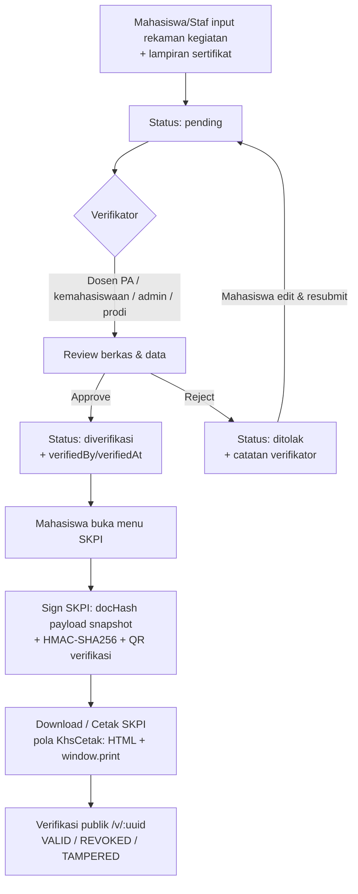

# PRD: Pengelolaan Pencapaian Kegiatan Mahasiswa untuk SKPI

- **Dokumen**: `docs/015_plan_skpi-pencapaian-kegiatan-20261014.md`
- **Tanggal**: 14 Oktober 2026
- **Penulis**: Senior System Analyst
- **Status**: Draft — Menunggu Review
- **Target Implementasi**: Feature branch → PR ke `development` (staging-first)

---

## 1. Ringkasan Fitur

**Surat Keterangan Pendamping Ijazah (SKPI)** adalah dokumen resmi yang merangkum pencapaian non-akademik mahasiswa: pelatihan, seminar, workshop, kegiatan organisasi, dan prestasi yang pernah diikuti selama studi. Saat ini tidak ada basis data terpusat untuk rekaman kegiatan tersebut — proses penyusunan SKPI masih manual (mencari data dan merangkum), rawan kehilangan bukti (sertifikat), dan lambat.

**Problem Statement (masukan pengguna):**

> *Data SKPI terkait pelatihan, seminar, atau kegiatan yang pernah diikuti mahasiswa. Sebaiknya terdapat basis data yang dapat diisi oleh mahasiswa atau admin dan diverifikasi kesesuaiannya oleh pihak terkait, sehingga dalam pencetakan SKPI tidak perlu mencari data dan merangkumnya lagi.*

**Solusi**: Modul basis data rekaman kegiatan mahasiswa dengan alur verifikasi berjenjang, lampiran bukti sertifikat, master kategori & poin kegiatan, serta menu cetak/download SKPI elektronik bertanda tangan digital (QR signed-hash, mengikuti pola TTE KHS Fase 1).

---

## 2. Tujuan & Stakeholder

### Tujuan
1. Menyediakan basis data rekaman kegiatan mahasiswa (pelatihan, seminar, workshop, organisasi, prestasi, kegiatan lain) yang dapat diisi mahasiswa/sendiri atau staf.
2. Menjamin kesesuaian data melalui verifikasi oleh pihak berwenang (Dosen Pendamping/PA, kemahasiswaan, admin/prodi) sebelum masuk ke dokumen SKPI.
3. Menyediakan tombol unduh/cetak SKPI mandiri di menu SKPI — dokumen tersusun otomatis dari rekaman terverifikasi, tanpa perlu merangkum manual.
4. Menjamin keaslian dokumen SKPI melalui tanda tangan elektronik QR signed-hash dan halaman verifikasi publik (pola KHS).

### Stakeholder & Peran

| Peran | Kebutuhan |
| :-- | :-- |
| **Mahasiswa** | Input & melacak rekaman kegiatannya; mengunggah bukti sertifikat; mengunduh/mencetak SKPI. |
| **Dosen Pendamping (PA)** | Memverifikasi (approve/reject + catatan) rekaman kegiatan mahasiswa bimbingannya (`mahasiswa.dosenPaId`). |
| **Kemahasiswaan** (role baru) | Memverifikasi rekaman lintas prodi dalam unit kerjanya; mengelola kategori & poin kegiatan. |
| **Admin / Prodi** | Verifikasi fallback dengan prodi-scoping; mengelola data & kategori. |
| **Kaprodi / Pimpinan** | Penandatangan SKPI (otomatis via `resolveSigner`); pemantau rekap kegiatan. |

---

## 3. User Stories & Prioritas (MoSCoW)

| # | User Story | Prioritas |
| :-- | :-- | :-- |
| US-1 | Sebagai mahasiswa, saya dapat menginput rekaman kegiatan (pelatihan/seminar/organisasi/prestasi) beserta lampiran sertifikat agar data saya tercatat. | **Must** |
| US-2 | Sebagai mahasiswa, saya dapat mengedit/menghapus rekaman saya selama masih berstatus `pending` atau `ditolak`. | **Must** |
| US-3 | Sebagai Dosen PA / kemahasiswaan / admin / prodi, saya dapat melihat antrean verifikasi rekaman kegiatan (dengan filter prodi/mahasiswa/status) dan menyetujui atau menolaknya beserta catatan verifikasi. | **Must** |
| US-4 | Sebagai mahasiswa, saya dapat mengunduh/mencetak SKPI dari menu SKPI yang berisi identitas saya + daftar kegiatan terverifikasi + tanda tangan digital QR verifikasi. | **Must** |
| US-5 | Sebagai admin/kemahasiswaan, saya dapat mengelola master kategori kegiatan (nama, jenis, bobot/poin, aktif) untuk penilaian pencapaian. | **Must** |
| US-6 | Sebagai kaprodi/pimpinan, SKPI yang saya tandatangani bersifat idempoten dan dapat diverifikasi publik melalui QR. | **Must** |
| US-7 | Sebagai mahasiswa, saya dapat melihat ringkasan poin pencapaian dari kegiatan terverifikasi di halaman SKPI saya. | **Could** |
| US-8 | Sebagai staf, saya dapat mengekspor rekap kegiatan per prodi/periode (PDF/Excel). | **Could** |
| US-9 | Sebagai admin, saya dapat menetapkan syarat minimum kegiatan terverifikasi sebelum SKPI dapat diterbitkan. | **Should** |

---

## 4. Alur Bisnis

### 4.1 Alur Utama — Input → Verifikasi → Cetak



### 4.2 State Machine Rekaman Kegiatan

| State | Aksi yang boleh | Penanggung jawab |
| :-- | :-- | :-- |
| `pending` | edit, hapus, submit verifikasi | Pemilik (mahasiswa/staf input) |
| `diverifikasi` | tidak bisa diedit (freeze data cetak) | Verifikator (approve) |
| `ditolak` | edit, resubmit ke `pending`, hapus | Verifikator (reject + catatan wajib) |

Aturan transisi (mengikuti pola `CutiService.approve` — `apps/backend/src/services/cuti.service.ts:241-302`):
- `pending → diverifikasi` / `pending → ditolak` oleh verifikator berwenang.
- `ditolak → pending` (resubmit) oleh pemilik; `pending → hapus` oleh pemilik.
- Rekaman `diverifikasi` **tidak dapat dihapus/diedit** oleh mahasiswa; koreksi oleh admin via mekanisme "unverify" (opsional, admin-only) yang mencatat audit log.

### 4.3 Otoritas Verifikasi (Role & Scoping)

**Penambahan role baru**: `kemahasiswaan` ditambahkan ke enum `user_role` (multi-role allowed, seperti `admin`/`prodi`).

Verifikator yang berwenang memverifikasi suatu rekaman kegiatan mahasiswa M:
1. **Dosen PA** — akun dosen yang cocok dengan `mahasiswa.dosenPaId` (pola guard `apps/backend/src/controllers/bimbingan.controller.ts:49-52`).
2. **Kemahasiswaan** — user dengan role `kemahasiswaan` (dibatasi prodi-scope-nya via `ProdiScopeService.getUserAccessibleProdiIds`).
3. **Admin / Prodi / Kaprodi** — role staf dengan prodi-scoping (admin global; prodi/kaprodi dibatasi `programStudiId`).

Dosen pengajar biasa (tanpa PA) dan mahasiswa lain **tidak** boleh memverifikasi.

### 4.4 Syarat Penerbitan SKPI
- Mahasiswa memiliki data identitas lengkap (NIM, nama, prodi, program studi) di tabel `mahasiswa`.
- Status akademik: `aktif`, `cuti`, atau `lulus` (SKPI boleh dicetak mahasiswa aktif maupun lulus).
- Minimum kegiatan terverifikasi: dikonfigurasi via `system_settings` (key: `skpi_min_kegiatan`, default `1`); jika belum terpenuhi, tombol cetak dinonaktifkan dengan pesan informatif.
- Hanya kegiatan berstatus `diverifikasi` yang dimasukkan ke dokumen.

---

## 5. Desain Data (Skema Database)

### 5.1 Tabel Baru

**`kategori_kegiatan_skpi`** — master kategori & bobot poin:

| Kolom | Tipe | Keterangan |
| :-- | :-- | :-- |
| `id` | serial PK | |
| `nama` | varchar (unique) | contoh: "Pelatihan", "Seminar", "Workshop", "Organisasi Kemahasiswaan", "Prestasi Akademik", "Prestasi Non-Akademik", "Magang/Praktik Kerja", "Kegiatan Sosial/Relawan" |
| `jenis` | varchar | `pelatihan` \| `seminar` \| `organisasi` \| `prestasi` \| `lainnya` |
| `poinDefault` | integer default 0 | bobot poin bawaan per kegiatan |
| `isAktif` | boolean default true | kategori dapat dinonaktifkan tanpa menghapus riwayat |
| `createdAt` / `updatedAt` | timestamp | |

**`kegiatan_mahasiswa_skpi`** — rekaman kegiatan:

| Kolom | Tipe | Keterangan |
| :-- | :-- | :-- |
| `id` | serial PK | |
| `mahasiswaId` | FK → `mahasiswa.id` | pemilik rekaman |
| `kategoriKegiatanId` | FK → `kategori_kegiatan_skpi.id` | |
| `namaKegiatan` | varchar NOT NULL | nama pelatihan/seminar/kegiatan |
| `penyelenggara` | varchar | instansi penyelenggara |
| `tanggalMulai` | date (`mode: 'string'`) | calendar date — pola `date()` sesuai AGENTS.md |
| `tanggalSelesai` | date nullable | |
| `lokasi` | varchar nullable | |
| `deskripsi` | text nullable | ursing singkat peran/hasil kegiatan |
| `nomorSertifikat` | varchar nullable | nomor/serial sertifikat |
| `poin` | integer default 0 | poin final (default dari kategori, boleh disesuaikan verifikator) |
| `status` | varchar default `'pending'` | `'pending'` \| `'diverifikasi'` \| `'ditolak'` (komentar enumerasi, pola `pengajuanCuti`) |
| `catatanVerifikator` | text nullable | wajib diisi saat reject |
| `verifiedById` | FK nullable → `users.id` | |
| `verifiedAt` | timestamp nullable | |
| `createdById` | FK → `users.id` | input (mahasiswa sendiri atau staf) |
| `createdAt` / `updatedAt` | timestamp | |

Index: `(mahasiswaId, status)`, `(status)` untuk antrean verifikasi.

**Lampiran bukti sertifikat**: reuse pola lampiran — buat tabel `lampiran_kegiatan_skpi` (atau genericisasi `statusMahasiswaLampiran` bila diperlukan) dengan kolom `kegiatanId` FK, `fileName`, `filePath` (storage `skpi/`), `mimeType`, `fileSize`, `uploadedById`, `createdAt`. Storage: `apps/backend/src/utils/lampiran-storage.ts` (direktori dibuat di `app.ts` saat boot, pola `storage/status-mahasiswa`). Batas: 1 lampiran opsional per kegiatan (PDF/JPG/PNG, maks 5 MB).

**`document_signatures`** — tidak ada perubahan skema; hanya perluasan `DocType` union (lihat §6.3).

### 5.2 Relasi
- `kegiatanMahasiswaSkpi.mahasiswa` → `mahasiswa` (many-to-one).
- `kegiatanMahasiswaSkpi.kategori` → `kategoriKegiatanSkpi` (many-to-one).
- `kegiatanMahasiswaSkpi.lampiran` → `many(lampiranKegiatanSkpi)`.
- `mahasiswa` → `many(kegiatanMahasiswaSkpi)`.

### 5.3 Migrasi
- File: `apps/backend/drizzle/0084_skpi_kegiatan_mahasiswa.sql`.
- **Idempoten wajib**: `CREATE TABLE IF NOT EXISTS`, `DO $$ ... ADD CONSTRAINT IF NOT EXISTS`, `CREATE INDEX IF NOT EXISTS` (gaya `0083_status_mahasiswa_lampiran.sql`).
- Role baru `kemahasiswaan`: `DO $$ BEGIN IF NOT EXISTS (...pg_enum...) THEN ALTER TYPE user_role ADD VALUE 'kemahasiswaan'; END IF; END $$;` (catatan: `ALTER TYPE ... ADD VALUE` tidak bisa di dalam transaksi — ikuti pola pasti dari migrasi enum sebelumnya).
- Alur: edit `schema.ts` → `bun run db:generate` → review SQL → commit `schema.ts` + `drizzle/` bersamaan (`docs/MIGRATION_WORKFLOW.md`).
- Deploy: **backup DB wajib** sebelum `db:safe-migrate` ke staging/produksi.

---

## 6. Spesifikasi API (Backend)

Prefix route: `/skpi`, semua endpoint terproteksi `authMiddleware` kecuali verifikasi publik.

### 6.1 Master Kategori
| Method & Path | Aksi | Otorisasi |
| :-- | :-- | :-- |
| `GET /skpi/kategori` | Daftar kategori aktif | semua role terautentikasi |
| `POST /skpi/kategori` | Buat kategori | `super_admin`, `admin`, `kemahasiswaan` |
| `PUT /skpi/kategori/:id` | Update kategori | idem |
| `DELETE /skpi/kategori/:id` | Hapus (hanya bila belum dipakai) | `super_admin`, `admin` |

### 6.2 Rekaman Kegiatan
| Method & Path | Aksi | Otorisasi |
| :-- | :-- | :-- |
| `GET /skpi/kegiatan` | Daftar rekaman (query: `mahasiswaId`, `status`, `kategoriId`, `page`, prodi scope otomatis) | mahasiswa: own-only; staf: sesuai scope |
| `POST /skpi/kegiatan` | Input rekaman (status `pending`) | `mahasiswa` (own), staf (untuk mahasiswa dalam scope) |
| `PUT /skpi/kegiatan/:id` | Edit (hanya `pending`/`ditolak`) | pemilik atau admin |
| `DELETE /skpi/kegiatan/:id` | Hapus (hanya `pending`/`ditolak`) | pemilik atau admin |
| `POST /skpi/kegiatan/:id/verifikasi` | Body: `action: 'approve' \| 'reject'`, `catatan?`, `poin?` | Dosen PA / `kemahasiswaan` / `admin` / `prodi` / `kaprodi` (prodi scope) |
| `POST /skpi/kegiatan/:id/lampiran` | Upload bukti (`t.File()`, pola `uploadLampiranCutiSchema`) | pemilik / staf scope |
| `DELETE /skpi/kegiatan/:id/lampiran/:lampiranId` | Hapus lampiran | pemilik / admin |

### 6.3 Dokumen SKPI (TTE/QR)
| Method & Path | Aksi | Otorisasi |
| :-- | :-- | :-- |
| `GET /skpi/dokumen/:mhsId` | Ambil ringkasan siap cetak (identitas + kegiatan terverifikasi + status signature bila ada) | mahasiswa own / staf scope |
| `POST /skpi/dokumen/:mhsId/sign` | Terbitkan signature (idempoten, pola `signKhs`) | mahasiswa own; staf `admin`/`prodi`/`kaprodi` scope |
| `GET /document-signatures/verify/:uuid` | **Sudah ada** — verifikasi publik tanpa auth | publik (`PUBLIC_NO_SESSION_PATHS` di `app.ts`) |

**Perubahan integrasi signing**:
- `apps/backend/src/services/document-signature.service.ts:24` — perluas `DocType` menjadi `'KHS' | 'TRANSKRIP' | 'SKPI'`.
- `refId` SKPI: `skpi:<mhsId>`; payload snapshot stabil: identitas mahasiswa (NIM, nama, prodi, jenjang), daftar kegiatan terverifikasi (nama, kategori, tanggal, penyelenggara), poin total, tahun terbit. **Field volatil (mis. `requestedByUserId`) tidak masuk hash** (aturan Fase 1).
- Idempoten per `(tenant, 'SKPI', 'skpi:<mhsId>')`; jika daftar kegiatan terverifikasi berubah setelah signing → revoke signature lama + insert baru (pola `signKhs` baris 189-212).
- Penandatangan: `resolveSigner(programStudiId)` (Kaprodi → fallback pimpinan) — tanpa perubahan.
- QR mengarah ke `VERIFY_BASE_URL` + `/v/:uuid` (env existing).

### 6.4 Skema & Pola Wajib
- Validasi input: TypeBox `t.*` di `apps/backend/src/schemas/skpi.schema.ts` (format `{ detail: { tags, summary, description }, body/query/params }`).
- Controller: static methods + destructure `AuthContext` + `getCurrentUser()`; `try/catch` → `{ error }` + status; dilarang `any` (kecuali pengecualian framework dengan biome-ignore).
- Service: static methods Drizzle ORM; klausul `where` eksplisit; state transition dijaga di service (throw `Error` untuk business logic).
- Semua mutasi tercatat otomatis via `audit.plugin.ts` (tanpa instrumentasi manual).
- File baru: `skpi.routes.ts`, `skpi.controller.ts`, `skpi.service.ts`, `skpi.schema.ts`; mount di `app.ts` (blok `.use(...)` route ± baris 429-481).

---

## 7. Spesifikasi UI (Frontend — SolidJS)

### 7.1 Menu & Routing

**Sidebar** (`apps/frontend/src/components/Sidebar.tsx`):
- Section **Layanan Mahasiswa** (± baris 1342): item **"SKPI Mahasiswa"** → `/skpi` (tampil untuk `isMahasiswa()`, `isMahasiswaOrMore()`).
- Section **Evaluasi & Kelulusan** (± baris 933): item **"Verifikasi SKPI"** → `/skpi/verifikasi` (tampil untuk `kemahasiswaan`/`admin`/`prodi`/`kaprodi`).
- Daftarkan path `/skpi` & `/skpi/verifikasi` di array auto-expand `isMatch([...])` (baris 122-149).
- Helper predikat baru `isKemahasiswaan()` bila diperlukan (polyfill role union).

**Routing** (`apps/frontend/src/App.tsx`):
```tsx
<Route path="/skpi" element={
  <ProtectedRoute allowedRoles={['mahasiswa','admin','prodi','kaprodi','dosen','kemahasiswaan','super_admin']}>
    <Skpi/>
  </ProtectedRoute>} />
<Route path="/skpi/verifikasi" element={...} />
<Route path="/skpi/cetak/:mhsId" element={...} />
```
- Lazy import untuk semua halaman baru (pola baris 22-107).
- **`ProtectedRoute.tsx:8-20`** — tambahkan `'kemahasiswaan'` ke union `allowedRoles`.

### 7.2 Halaman

| Route | File | Fitur |
| :-- | :-- | :-- |
| `/skpi` | `routes/Skpi.tsx` | Halaman mahasiswa: daftar rekaman (status badge, poin), form tambah/edit (kategori, nama, penyelenggara, tanggal, deskripsi, nomor sertifikat), upload lampiran, tombol hapus/resubmit (hanya `pending`/`ditolak`), ringkasan poin terverifikasi, **tombol "Unduh/Cetak SKPI"** (aktif bila syarat §4.4 terpenuhi → `/skpi/cetak/:mhsId` di tab baru). Untuk staf: daftar rekaman mahasiswa dalam scope. |
| `/skpi/verifikasi` | `routes/SkpiVerifikasi.tsx` | Panel verifikator: filter status `pending` (default), prodi, mahasiswa, kategori; detail rekaman + preview lampiran; aksi Approve (opsional ubah poin) / Reject (catatan wajib, modal konfirmasi pola `kompensasi/VerifyModal.tsx`). |
| `/skpi/cetak/:mhsId` | `routes/SkpiCetak.tsx` | Dokumen cetak — **pola `KhsCetak.tsx`**: `createResource` GET dokumen, regenerasi QR via `QRCode.toDataURL(verifyUrl)`, auto-print setelah siap, tombol Cetak, blok tanda tangan (nama jabatan penandatangan dari `resolveSigner`) + `docHash`/`verifyUuid` di footer, modal konfirmasi satu-satunya jalur penerbitan signature. |

### 7.3 Aturan Komponen (DESIGN.md + AGENTS.md)
- Komponen: `export default function X()` dibungkus `<MainLayout>`.
- SolidJS primitives (`createSignal`, `createResource`, `createMemo`); **tanpa destruktur props**; `<For>` bertipe (named interface / `SafeAny`).
- Date handling: kolom `date()` = string `YYYY-MM-DD` polos — **dilarang** `new Date(x).toISOString().split('T')[0]`.
- Timestamp Eden dikirim sebagai `Date` → sanitize ke locale string saat render.
- Estetika Apple: pill buttons (`rounded-full`), hairline divider, ink `#1d1d1f`, parchment `#f5f5f7`, Action Blue `#0066cc`, `active:scale-95`.
- Frontend controller: `controllers/skpiController.ts` berbasis `fetchApi`, export interface tipe (`SkpiKegiatan`, `SkpiKategori`) untuk dipakai ulang di props/state.

---

## 8. Dokumen SKPI — Komponen Cetak

Struktur dokumen (A4 portrait, HTML + `window.print()`):
1. **Kop surat** kampus (polo surat institusi).
2. **Judul**: "SURAT KETERANGAN PENDAMPING IJAZAH (SKPI)" + nomor (auto, format internal).
3. **Identitas mahasiswa**: NIM, nama lengkap, program studi, jenjang, tahun akademik masuk/akhir, status kelulusan.
4. **Daftar kegiatan terverifikasi** (tabel, diurut `tanggalMulai` asc): No., Nama Kegiatan, Jenis/Kategori, Penyelenggara, Tanggal, Lokasi, Nomor Sertifikat.
5. **Rekap poin** pencapaian (total poin kegiatan terverifikasi).
6. **Pernyataan** keaslian data (dapat diverifikasi melalui QR).
7. **Blok tanda tangan**: tempat & tanggal terbit, nama & jabatan penandatangan (Kaprodi/Pimpinan), QR verifikasi + teks `verifyUuid`.
8. **Footer teknis** (kecil): `docHash` (prefix) & tautan verifikasi — pola footer `KhsCetak.tsx`.

Pilihan download: **PDF via print dialog** (Save as PDF) — konsisten dengan KHS; tidak perlu jsPDF untuk dokumen ini.

---

## 9. Keamanan & Scoping

1. **Own-only mahasiswa**: `GET/POST/PUT/DELETE /skpi/kegiatan*` — non-staf hanya boleh akses rekaman miliknya (`mahasiswaId` = record milik akun, pola `getMahasiswaIdByEmail`).
2. **Prodi scope**: semua akses staf melalui `ProdiScopeService.canAccessProdi` / `assertMahasiswaInScope` (admin global bypass).
3. **Guard Dosen PA**: verifikasi dosen hanya bila `mahasiswa.dosenPaId === dosenId` akun.
4. **Rekaman `diverifikasi` freeze**: service menolak edit/hapus non-admin.
5. **Upload lampiran**: validasi MIME/ekstensi whitelist (pdf/jpg/png), maks 5 MB, nama file di-random (pola `lampiran-storage.ts`), disajikan via endpoint terautentikasi (bukan path publik).
6. **Signing**: secret HMAC hanya via env `SIGN_HMAC_KEYS`/`SIGN_ACTIVE_KID`; jangan hardcode domain (`VERIFY_BASE_URL`).
7. **Audit log** otomatis untuk semua mutasi CRUD & verifikasi.
8. **Endpoint publik** tetap hanya `GET /document-signatures/verify/:uuid` yang terdaftar di `PUBLIC_NO_SESSION_PATHS`.

---

## 10. Penerimaan Kriteria (Acceptance Criteria)

| US | Acceptance Criteria |
| :-- | :-- |
| US-1 | Mahasiswa dapat membuat rekaman kegiatan dengan semua field wajib; status awal `pending`; lampiran (PDF/JPG/PNG ≤5 MB) terunggah dan bisa dipratinjau verifikator. |
| US-2 | Edit/hapus hanya berfungsi pada `pending`/`ditolak`; percobaan pada `diverifikasi` ditolak dengan pesan jelas. |
| US-3 | Verifikator berwenang melihat antrean `pending`; approve memerlukan konfirmasi; reject mewajibkan catatan; verifikator di luar cakupan (dosen non-PA, mahasiswa lain) menerima 403. |
| US-4 | Tombol "Unduh/Cetak SKPI" menghasilkan halaman cetak berisi identitas + tabel kegiatan terverifikasi + QR + blok tanda tangan; hanya kegiatan `diverifikasi` yang tampil; memicu `window.print()`. |
| US-5 | Admin/kemahasiswaan dapat CRUD kategori; menonaktifkan kategori tidak menghapus riwayat rekaman lama; kategori non-aktif tidak muncul di form input baru. |
| US-6 | `POST /sign` idempoten untuk payload sama; perubahan daftar kegiatan terverifikasi menyebabkan signature lama revoked dan QR baru valid; verifikasi publik mengembalikan `VALID`. |
| US-9 | Bila jumlah kegiatan terverifikasi < `skpi_min_kegiatan`, tombol cetak disabled dengan pesan; nilai setting dapat diubah admin via system settings. |

---

## 11. Risiko & Pertimbangan

| Risiko | Mitigasi |
| :-- | :-- |
| Penambahan role `kemahasiswaan` menyentuh banyak titik (enum DB, `ProtectedRoute`, `Sidebar`, `role.ts` `ROLE_LABELS`, RBAC bila ada) | Migrasi idempoten; checklist file wajib di §5.3 & §7.1; lint/typecheck menyeluruh |
| `ALTER TYPE ... ADD VALUE` tidak dalam transaksi | Ikuti pola migrasi enum pasti di repo; jalankan via `db:safe-migrate` dengan backup |
| Data kegiatan berubah setelah SKPI ditandatangani → dokumen cetak tidak konsisten dengan snapshot | Idempotent re-sign: snapshot hash berubah → revoke + insert baru (pola KHS); QR lama tampil `REVOKED` |
| Pemalsuan upload sertifikat | Verifikator wajib memeriksa lampiran; catatan verifikasi tercatat; audit log penuh; skala manual trust institution |
| Dokumen SKPI format institusi bervariasi antar kampus | Kop, nomor surat, dan paragraf pembuka dikonfigurasi (opsional `system_settings`) agar mudah disesuaikan tanpa perubahan kode |
| Flaky integration test seeding berat | Test file skpi dijalankan scoped (`bun test apps/backend/src/__tests__/skpi*.test.ts --timeout 15000`) |

---

## 12. Rencana Verifikasi & Testing

### Pre-commit (wajib)
```bash
bun run lint
cd apps/backend && bunx tsc --noEmit -p tsconfig.ci.json
cd apps/frontend && bunx tsc --noEmit
```

### Backend Integration Test (scoped)
- File baru: `apps/backend/src/__tests__/skpi.test.ts` — skenario: CRUD kegiatan own-only; guard dosen PA; reject wajib catatan; freeze rekaman `diverifikasi`; sign idempoten; re-sign saat data berubah.
- Jalankan: `cd apps/backend && bun run src/scripts/pre-test.ts && bun run test --timeout 15000 src/__tests__/skpi.test.ts` (Postgres test di `localhost:5433` aktif).
- **Dilarang** blanket `bun test` di root.

### Uji Manual Flow
1. Mahasiswa login → input kegiatan + lampiran → cek status `pending`.
2. Dosen PA login → verifikasi panel → approve → rekaman masuk dokumen.
3. Mahasiswa → menu SKPI → Unduh/Cetak → QR tampil → scan/verify → `VALID`.
4. Verifikator lain (non-PA, non-scope) → 403.
5. Admin ubah kategori non-aktif → form baru tidak menawarkan kategori tsb.

### CI/CD
- PR feature → `development` (staging-first); verifikasi staging; promosi `development -> main` via PR terpisah.
- Backup DB produksi wajib sebelum migrate.

---

## Lampiran A: File yang Disentuh Implementasi

**Backend (baru)**: `src/schemas/skpi.schema.ts`, `src/services/skpi.service.ts`, `src/controllers/skpi.controller.ts`, `src/routes/skpi.routes.ts`, `src/__tests__/skpi.test.ts`, `drizzle/0084_skpi_kegiatan_mahasiswa.sql`.

**Backend (edit)**: `src/models/schema.ts` (3 tabel + relasi + enum role), `src/app.ts` (mount route + storage dir), `src/services/document-signature.service.ts` (`DocType` + `signSkpi`), `src/utils/role.ts` (label role).

**Frontend (baru)**: `src/routes/Skpi.tsx`, `src/routes/SkpiVerifikasi.tsx`, `src/routes/SkpiCetak.tsx`, `src/controllers/skpiController.ts`.

**Frontend (edit)**: `src/App.tsx` (lazy + routes), `src/components/Sidebar.tsx` (menu + auto-expand), `src/components/ProtectedRoute.tsx` (union role).
